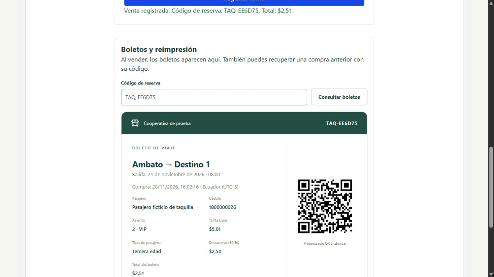

# CR-07 — Boleto térmico, reimpresión y tarifas de pasajeros

Expediente: **SCR-USR-2026-001**, cambio Estándar. Responsable: Cristian
(@Cristian-1402). Rama: `hotfix/cr-07-boleto-termico-taquilla`, desde `main`
v1.8.0 (`86146fc`). Meta: **v1.8.1**. Revisores: @SnaiderToainga y @joel427.

## Qué cambia en la aplicación

| Requisito | Resultado |
| --- | --- |
| VENT-01, VENT-02, VENT-21 | Venta con varios pasajeros/asientos. Cada pasajero envía su tipo de tarifa y cédula; el servidor valida identidad, calcula la tarifa y guarda el desglose. |
| VENT-03 | La taquilla y el boleto muestran tarifa base, tipo de pasajero, descuento y total individual. |
| VENT-04, VENT-05 | Después de vender aparecen los boletos dentro de la misma pantalla. El PDF tiene ancho real de 80 mm, altura variable, una página por pasajero y QR legible. Acciones «Abrir / imprimir (80 mm)» y descarga PDF. |
| VENT-06 | Se conserva el código de reserva y el correo de confirmación. No se envía a un correo ficticio si la venta no tiene destinatario. |
| VENT-23 | Compra con fecha, hora y segundos en Ecuador (UTC-5), separada de la salida del viaje, tanto en boleto como en correo. |
| Recuperación permanente | El código de una compra pagada permite volver a consultar y descargar los mismos boletos, incluso tras recargar. No se recrea la reserva, no se cambia el QR guardado ni se reinicia el abordaje. |

En venta web se conserva el flujo de reserva y aprobación del comprobante. La
fecha de **compra** se registra al aprobar el pago; en taquilla, al confirmar la
venta pagada. `creado_en` sigue siendo la fecha de **reserva**.

## Tarifas y compatibilidad

- Tipos: `NORMAL`, `MENOR`, `TERCERA_EDAD`, `DISCAPACIDAD`. Se acepta `NIÑO`/`NINO`
  del checkout anterior y se almacena `MENOR`. Los tres beneficios son del 50 %.
- La fuente de precio es `frecuencias.precio_base`; los importes enviados por el
  navegador no determinan el cobro. No se inventan recargos VIP inexistentes en el
  catálogo. Se conserva la categoría del asiento.
- El cálculo trabaja en centavos. Por ejemplo, base $ 5.01: tarifa completa
  $ 5.01; beneficio $ 2.51; descuento efectivo redondeado $ 2.50. La suma de
  boletos determina el total de la reserva.
- El frontend envía `tramo: { inicio, fin }` usando índices del itinerario oficial.
  El servidor valida sus límites y calcula la tarifa proporcional de CR-05. Si
  se omite, se cobra el trayecto completo. Origen y destino se guardan como
  instantánea para consulta, historial, PDF y correo.
- Se validan cédula ecuatoriana y nombres; no se repite cédula ni asiento dentro
  de la operación. Una cédula válida **no acredita por sí sola edad o discapacidad**.
  La selección del beneficio queda registrada; su acreditación documental debe
  comprobarse operativamente. No existe consulta a un registro oficial de edad
  o discapacidad en este cambio.
- Se mantienen identificadores de reserva, boleto, asiento y tokens QR. El PDF
  utiliza el enlace existente `/validar?reserva=...&asiento=...`.
- Los boletos históricos conservan su precio y QR. Cuando no hay desglose ni
  fecha exacta de compra se indica «no registrado», sin inferir descuentos ni
  sustituir la fecha de compra por la reserva o por la hora de impresión.

## Migración y despliegue

Archivo: `backend/database/05_boletos_termicos_tarifas.sql`.

1. Revisar el PR y obtener 2/2 aprobaciones independientes. Antes del merge que
   dispara los despliegues automáticos, completar el respaldo y la migración
   aditiva de los pasos 2 y 3, compatibles con el código v1.8.0 en ejecución.
2. Coordinar ventana y conservar versión v1.8.0 y respaldo privado de Supabase.
   Verificar su restauración antes de modificar producción.
3. Ejecutar **únicamente la migración 05**, después de la 04, usando la conexión
   administrada del proyecto. No ejecutar `01_schema.sql`: recrea las tablas.
4. La migración es transaccional, aditiva y repetible: añade `comprado_en`,
   `origen_tramo`, `destino_tramo` a reservas y `tipo_pasajero`, `tarifa_base`,
   `descuento` a detalle. Una restricción comprueba coherencia aritmética. No
   rellena valores históricos desconocidos ni modifica compras previas.
5. Integrar a `main` mediante merge commit, conservar la rama y desplegar backend
   y frontend de manera coordinada. El código CR-07 requiere la migración 05;
   el código v1.8.0 sigue admitiendo las columnas nuevas sin usarlas.
6. Verificar venta, aprobación web, correo a destinatario autorizado, recuperación
   de compra anterior y QR. Probar impresora de 80 mm a escala real (100 %).
7. Publicar tag v1.8.1 sobre el merge oficial solo después de la integración.
   Vincular evidencias, registrar PIR y cerrar el expediente tras validación.
   No sincronizar `develop` durante este cambio: se hace al final del ciclo.

**Estado de esta entrega:** migración aplicada solo en PostgreSQL aislado de
pruebas. Producción no ha sido migrada ni desplegada para CR-07. No requiere
variables de entorno nuevas ni instalaciones adicionales de paquetes.

## Pruebas reproducibles

Desde `backend`: `npm test`. La suite crea PostgreSQL en memoria con PGlite;
no carga `DATABASE_URL`. Los correos se sustituyen por un receptor de prueba,
sin conexiones SMTP/Resend ni destinatarios reales. Desde `frontend`:
`npm test` y `npm run build`.

Se cubren los cuatro tipos de pasajero, precios manipulados, redondeo,
tramos intermedios, identidad inválida, reversión de operaciones inválidas,
conservación de tarifa tras cambiar el catálogo, hora de aprobación, contenido
de correo escapado, reimpresión, bloqueo de boletos impagados/ajenos, QR y
abordaje conservados, migración repetida y compatibilidad histórica. También
se revisa el PDF de nombres largos en una página de 80 mm.

Resultado local: **42/42 pruebas backend y 20/20 frontend aprobadas**, build
correcto y sintaxis backend verificada. El adaptador de
pruebas reproduce el `rowCount` de PostgreSQL también en consultas SELECT;
las peticiones de regresión que crean pasajeros utilizan una cédula de ejemplo
válida, mientras los registros históricos ficticios se conservan sin revalidar.

Evidencia local adicional (fuera del repositorio): PDF ficticio renderizado y
revisado visualmente, QR extraído del PDF y decodificado, venta desde sesión
de oficinista en navegador y recuperación por código tras recargar. Los archivos
están en `outputs/cr07` del espacio de trabajo de Codex. No son datos productivos.

**Pendiente de verificación externa:** impresora térmica física, recepción de
correo en buzón real y validación del despliegue. El build mantiene la advertencia
previa de tamaño del paquete, sin impedir la compilación.

## Reversión

Si falla la emisión, el cálculo o la recuperación, suspender las operaciones
afectadas y conservar logs y compras. Priorizar una corrección revisada. Una
reversión de la emisión a v1.8.0 debe conservar la protección de sesión y
cooperativa de este parche o mantener taquilla fuera de servicio hasta recuperarla;
revertir todo sin ese control reintroduciría el acceso anónimo corregido.
**Conservar las columnas aditivas y sus datos**: el código anterior admite esas
columnas y no es necesario eliminarlas. No regenerar QR ni restaurar un respaldo
encima de compras posteriores. Conciliar transacciones y registrar el resultado
en PIR.

## Corrección de seguridad incluida por solicitud de Cristian

Se corrigió el acceso anónimo detectado durante CR-07. Cada alias de
`officeRoutes.js`, en ambos montajes `/api` y `/api/oficina`, exige sesión firmada
y rol `OFICINISTA` o `SUPERADMIN`. La sesión consulta el rol y cooperativa actuales
en la base; no acepta permisos enviados en cabeceras o en el cuerpo de petición.
La bandeja y hoja de ruta se filtran por cooperativa; venta, aprobación, rechazo
y estados verifican tanto el bus como la frecuencia dentro de la transacción.
SuperAdmin conserva acceso global. Las sesiones revocadas, cuentas de otra
cooperativa, roles ajenos y firmas alteradas se rechazan sin modificar la operación.

El QR legado de oficina `/boletos/validar-qr` también requiere sesión y ámbito,
con actualización atómica que evita doble marcado. Las rutas específicas de
taquilla se registran antes de la consulta pública `/reservas/:codigo`, para que
el alias `/reservas/pendientes` no se interprete como un código de reserva.
La consulta pública y descarga por código de reserva conservan el comportamiento
existente. Esta entrega no constituye una auditoría global de seguridad de la app.

El panel envía el token de la sesión al consultar, vender y validar comprobantes.
La lista de viajes de taquilla procede de su hoja de ruta autorizada. Las cuentas
sin token deben iniciar sesión nuevamente. Una cuenta de oficinista sin cooperativa
asignada permanece bloqueada: gerencia debe completar su asignación real, sin
asignar cooperativas por defecto ni inventar permisos.

Las ocho pruebas de seguridad adicionales recorren todos los alias y montajes,
roles no autorizados, firmas adulteradas, intentos entre cooperativas, revocación
de permisos, acceso legítimo, estados y conservación del catálogo público.
En navegador se verificaron inicio de sesión de oficinista, lectura de bandeja,
aprobación de comprobante ficticio, nueva venta con descuento y emisión del boleto,
usando PostgreSQL aislado y sin correos reales.

