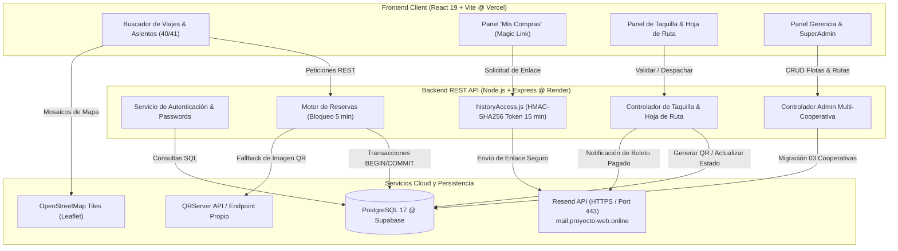
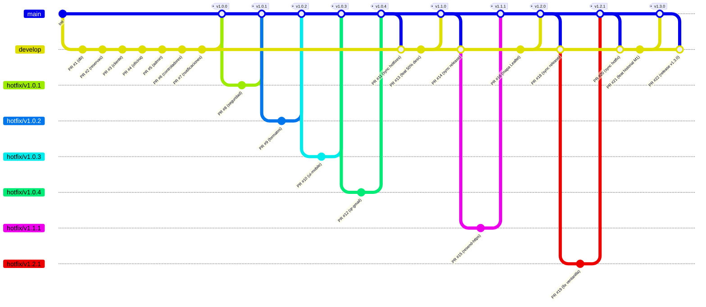

# Guía Técnica de Defensa y Auditoría SCM: APIs, Gitflow, Tags y Releases
**Proyecto:** Sistema Web "En ruta - Transporte UTA"  
**Asignatura:** Manejo y Configuración del Software (FISEI - Universidad Técnica de Ambato)  
**Grupo:** G03  
**Fecha de Auditoría:** Noviembre 2026  
**Línea Base Oficial:** Release `v1.3.0` (Línea base cerrada y desplegada en producción)  

---

## 🎯 1. Resumen Ejecutivo del Proyecto

El sistema **"En ruta - Transporte UTA"** es una plataforma web integral para la venta, emisión, control y validación de pasajes de transporte interprovincial en el Ecuador, con arquitectura multi-cooperativa orientada a empresas como **Cooperativa de Transportes CITA** y **Flota Pelileo Express**.

### Arquitectura Tecnológica Distribuida:
* **Frontend:** Single Page Application (SPA) desarrollada en **React 19** con **Vite**, estilizada con TailwindCSS y CSS modular responsivo, desplegada de forma continua en **Vercel** ([https://proyecto-web.online](https://proyecto-web.online)).
* **Backend:** Servicio RESTful en **Node.js 22** con **Express**, empaquetado y desplegado de forma continua en **Render** ([https://transporte-uta-api.onrender.com](https://transporte-uta-api.onrender.com)).
* **Base de Datos:** Motor relacional **PostgreSQL 17** alojado en la nube en **Supabase** (Cluster AWS `sa-east-1` en São Paulo) con esquema normalizado en 3FN, claves foráneas, restricciones de integridad y pool de conexiones administrado.
* **Integración Cloud:** Despacho de correo transaccional vía **Resend REST API (HTTPS)** con dominio propio verificado (`mail.proyecto-web.online`), mapas con **Leaflet / OpenStreetMap**, y generación de códigos QR redundantes (algoritmo local + motor público QRServer).

---

## 📋 2. Matriz de Cumplimiento de Requerimientos (PDF Oficial vs. Implementado)

En la siguiente tabla se detalla cómo el sistema cumple cada uno de los requerimientos especificados en el documento oficial de la asignatura (**`01_PROYECTO_SEGUNDO_PARCIAL_V2.pdf`**):

| Requerimiento del PDF Oficial | Estado en v1.3.0 | Módulo y Evidencia en el Código |
| :--- | :---: | :--- |
| **Operaciones CRUD completas** (Cooperativas, Frecuencias, Buses). | **CUMPLIDO** | `GestionCooperativas.jsx` y `adminController.js`: Altas, bajas, modificaciones y consultas reactivas con sincronización a la nube. |
| **Diferenciación de roles de usuario** (SuperAdmin, Gerente de cooperativa, Oficinista, Cliente). | **CUMPLIDO** | Control de acceso basado en roles (**RBAC**): `Login.jsx`, `authGuard.js`, y separación de paneles de administración, taquilla y compras públicas. |
| **Gestión de buses propios por cooperativa** (Aislamiento de flota). | **CUMPLIDO** | Con la migración `03_usuarios_cooperativa.sql`, cada cuenta de gerente (`ADMIN_COOP`) se aísla por `cooperativa_id`: CITA solo opera buses CITA y Pelileo solo opera flota Pelileo. |
| **Venta y gestión de boletos en rol oficinista** (Taquilla). | **CUMPLIDO** | `/oficina` (`OfficeDashboard.jsx`, `VentaVentanilla.jsx`, `ValidacionComprobantes.jsx`): Bandeja de depósitos bancarios, venta presencial en efectivo y emisión inmediata de boletos. |
| **Búsqueda de destinos y frecuencias disponibles**. | **CUMPLIDO** | `SearchTrips.jsx`: Filtros por origen, destino, fecha de viaje, cooperativa, categoría de asiento (Normal/VIP) y rango horario. |
| **Información relevante del viaje y mapa de ruta**. | **CUMPLIDO** | Visualización de resolución ANT, número de unidad, capacidad, servicio directo/paradas, baño posterior y trazado cartográfico con **Leaflet (OpenStreetMap)**. |
| **Compra de boletos y generación de código de acceso (QR)**. | **CUMPLIDO** | Motor de reservas con bloqueo temporal de 5 minutos (`bookingController.js`), emisión de boletos con token único QR individual por pasajero y renderizado en web, PDF y correo electrónico. |
| **Historial de compras para usuarios**. | **CUMPLIDO** | Pestaña **"Mis compras"** (`HistorialCompras.jsx`): Consulta segura mediante **Magic Link temporal (15 min)** firmado con HMAC-SHA256 (`historyAccess.js`), listado con filtros de fecha y acceso directo al boleto con QR. |
| **Configuraciones de asientos de buses (40 / 41 plazas)**. | **CUMPLIDO** | Generación algorítmica de grillas físicas: 40 asientos (con baño posterior en esquina trasera) y 41 asientos (fila corrida continua al fondo), con discriminación Normal vs. VIP. |
| **Descuentos de ley del 50% (Tercera edad, Menores, Discapacidad)**. | **CUMPLIDO** | `Checkout.jsx`: Selector de tarifa preferencial que reduce automáticamente el valor total al 50% y etiqueta el nombre del pasajero para validación en puerta. |
| **Hoja de ruta diaria y estados de viaje**. | **CUMPLIDO** | `HojaRuta.jsx`: Gestión de ciclos de vida (`PROGRAMADO` $\rightarrow$ `EN_RUTA` $\rightarrow$ `FINALIZADO`), reflejándose reactivamente en el portal de búsqueda pública. |
| **Configuración institucional de la aplicación**. | **CUMPLIDO** | `PersonalizacionBranding.jsx`: Edición de logos, colores corporativos hexadecimales, RUC y cuentas bancarias oficiales por cooperativa. |

---

## 🛡️ 3. Estrategia SCM: Deuda Técnica y Brechas Reservadas para el Control de Cambios (CCB / Jira)

> [!IMPORTANT]
> **Fundamento Pedagógico para la Defensa:**  
> En *Manejo y Configuración del Software*, el profesor evalúa la capacidad del equipo de **simular un proceso completo de gestión del cambio (Change Management / ITIL / CCB)**. Si el software se entregase con el 100% de características congeladas y sin fallas, **no existiría justificación real para abrir peticiones de cambio en Jira Service Management ni para convocar al Comité de Control de Cambios (CCB)**.

Por esta razón, la versión `v1.3.0` se estableció como la **Línea Base Oficial Auditada (Baseline)**, documentando formalmente las siguientes brechas y deudas técnicas para ser gestionadas como **Peticiones de Cambio (Change Requests - CRs)**:

```
┌────────────────────────────────────────────────────────────────────────────────────────┐
│                   CATÁLOGO DE PETICIONES DE CAMBIO PARA EL CCB EN JIRA                 │
├────────┬──────────────────────────────────────────┬──────────────────┬─────────────────┤
│ TICKET │ DESCRIPCIÓN DEL REQUERIMIENTO / DEFECTO │ TIPO DE CAMBIO   │ DICTAMEN CCB    │
├────────┼──────────────────────────────────────────┼──────────────────┼─────────────────┤
│ CR-01  │ Módulo Chofer: Escáner QR de Abordaje    │ Nueva Feature    │ APROBADO        │
│ CR-02  │ Seguridad: Middleware JWT en Rutas Admin │ Seguridad / Tech │ APROBADO        │
│ CR-03  │ Ficha Técnica del Bus (Chasis/Foto M2)   │ Mejora UI/UX     │ APROBADO        │
│ CR-04  │ Días de Parada: Calendario de Flota (M5) │ Regla de Negocio │ EN REVISIÓN     │
│ CR-05  │ Venta entre Paradas Intermedias (M3)     │ Cambio Complejo  │ POSTERGADO/RECH.│
└────────┴──────────────────────────────────────────┴──────────────────┴─────────────────┘
```

### Detalle de los Casos de Estudio para el Comité:

1. **`CR-01` (Módulo Chofer / Escáner de Boletos en Puerta):**
   * **Situación:** El backend ya cuenta con la lógica operativa en `POST /api/boletos/validar-qr` (comprobando que el boleto esté pagado y marcando `validado_en_puerta = TRUE` para impedir reusos). Sin embargo, se reservó la pantalla web móvil del chofer con lector de cámara para ser desarrollada bajo el ciclo formal de cambio en Jira.
2. **`CR-02` (Seguridad en Endpoints Administrativos):**
   * **Situación:** Las rutas `/api/admin/*` devuelven catálogos al frontend, pero la validación de sesión residía exclusivamente en el cliente (`localStorage`). El CCB aprueba incorporar un middleware de verificación de firmas JWT en el servidor.
3. **`CR-05` (Venta Fraccionada entre Paradas Intermedias):**
   * **Situación Magistral de Defensa:** El CCB analiza la solicitud de vender tramos parciales (ej. Latacunga $\rightarrow$ Cuenca en un bus Quito $\rightarrow$ Loja). Tras el análisis de impacto técnico, el Comité dictamina **POSTERGAR** el cambio para la versión 2.0 debido al alto riesgo de alterar el modelo relacional de `programacion_viajes` y la matriz de precios. Esto demuestra que el equipo aplica un control de cambios real y no aprueba modificaciones riesgosas a ciegas.

---

## 🔑 4. Matriz de Credenciales Oficiales del Sistema

Tras la actualización de seguridad de la versión `v1.3.0`, se eliminaron los atajos automáticos en pantalla para simular un inicio de sesión administrativo real. Para acceder a cada subsistema en [https://proyecto-web.online/#login](https://proyecto-web.online/#login) o localmente, se utilizan las siguientes credenciales:

| Rol / Subsistema | Correo Electrónico | Contraseña | Alcance y Permisos Operativos |
| :--- | :--- | :--- | :--- |
| **SuperAdministrador** | `admin@transporteuta.com` | `admin123`<br>*(o `hash_admin_123`)* | **Control Global del Sistema:** CRUD de todas las cooperativas, frecuencias ANT nacionales, creación de usuarios de personal y visión total de flotas. |
| **Gerente de Cooperativa (CITA)** | `gerente@cita.com` | `admin123` | **Gestión Exclusiva CITA (ID 1):** Acceso al panel institucional azul, supervisión de buses de CITA (#15, #18), frecuencias de CITA y conmutación de estado (Operativo / Mantenimiento). |
| **Gerente de Cooperativa (Pelileo)** | `gerente@pelileo.com` | `admin123`<br>*(o `pelileo123`)* | **Gestión Exclusiva Pelileo (ID 2):** Acceso al panel institucional rojo, administración de unidades (#5) y rutas oficiales de Flota Pelileo Express. |
| **Oficinista / Taquilla** | `taquilla@transporteuta.com` | `taquilla123`<br>*(o `hash_oficina_123`)* | **Módulo Operativo (`/oficina`):** Validación y aprobación de comprobantes bancarios, venta directa de pasajes en ventanilla y control de la Hoja de Ruta Diaria. |
| **Cliente / Pasajero** | *Cualquier correo personal*<br>*(ej. cliente@gmail.com)* | *Sin contraseña* | **Portal Público:** Búsqueda libre, reserva con descuento del 50%, subida de comprobantes y consulta en **"Mis compras"** mediante Magic Link temporal de 15 minutos enviado a su buzón. |

---

## 🌐 5. Arquitectura del Sistema y Catálogo Integral de APIs



### 5.1. APIs Externas Consumidas

1. **API REST de Resend (Email Transaccional sobre HTTPS):**
   * **Endpoint:** `POST https://api.resend.com/emails` (TLS 1.3 / Puerto 443).
   * **Propósito:** Envío del Magic Link para "Mis compras" y despacho de boletos confirmados.
   * **Ventaja Técnica:** Los puertos SMTP (25, 465, 587) están cerrados en Render Free. Al usar la API REST sobre el puerto 443, el tráfico nunca se bloquea.
   * **Gobernanza DNS:** Dominio `mail.proyecto-web.online` configurado en GoDaddy con registros **DKIM** y **SPF**, evitando que los mensajes caigan en Spam.
2. **API de Mosaicos de OpenStreetMap (Leaflet Tile Server):**
   * **Endpoint:** `https://{s}.tile.openstreetmap.org/{z}/{x}/{y}.png`.
   * **Propósito:** Trazado de rutas oficiales ANT y puntos de parada intermedia en tiempo real sin requerir APIs comerciales de pago.
3. **API Redundante de Códigos QR (QRServer Engine):**
   * **Endpoint:** `https://api.qrserver.com/v1/create-qr-code/?size=250x250&data=...&color=1e3a8a`.
   * **Propósito:** Garantizar que los correos en Gmail y la vista web carguen el código QR instantáneamente si el navegador del cliente no soporta canvas local.

### 5.2. Catálogo de Rutas de la API Interna Express

| Método | Endpoint | Módulo | Función Técnica |
| :---: | :--- | :--- | :--- |
| `POST` | `/api/mis-compras/acceso` | Historial | Valida formato de correo, verifica límites de tasa y despacha el Magic Link firmado. |
| `GET` | `/api/mis-compras` | Historial | Valida el Bearer Token en cabecera y retorna las reservas del pasajero. |
| `GET` | `/api/reservas/:c/boletos/:id/qr` | Boletos | Endpoint interno que genera el PNG del QR para visualización segura sin servicios externos. |
| `POST` | `/api/reservas` | Reservas | Inicia transacción `BEGIN`, valida que los asientos no estén ocupados y genera el bloqueo de 5 min. |
| `POST` | `/api/reservas/:c/comprobante` | Comprobantes | Sube archivo JPG/PNG/PDF (máx 5 MB) mediante `multer` y cambia estado a `review`. |
| `PUT` | `/api/oficina/reservas/:id/aprobar` | Taquilla | Aprueba el depósito, genera los tokens QR en BDD y dispara el correo de confirmación. |
| `POST` | `/api/venta-ventanilla` | Taquilla | Venta presencial en taquilla en efectivo, emitiendo boletos pagados al instante. |
| `GET` | `/api/hoja-ruta` | Operación | Consulta los viajes de la fecha actual y permite actualizar estado (`EN_RUTA`, `FINALIZADO`). |
| `POST` | `/api/boletos/validar-qr` | Abordaje | Endpoint de control de acceso en puerta: verifica estado pagado y marca `validado_en_puerta = TRUE`. |
| `POST` | `/api/admin/login` | Seguridad | Autenticación administrativa con verificación criptográfica de contraseña y resolución de cooperativa. |
| `POST` | `/api/admin/usuarios` | Personal | Da de alta usuarios administrativos asignando `cooperativa_id` obligatorio para gerentes. |

---

## 🌳 6. Gobernanza GitFlow y Trazabilidad de los 22 Pull Requests

El repositorio evidencia un desarrollo colaborativo impecable estructurado en **22 Pull Requests cerrados y fusionados**, cumpliendo sin excepciones la política de **Revisión por Pares (2/2)** y Conventional Commits:



### Registro Cronológico de los 22 Pull Requests:

1. **PR #1:** `feat(db): modelado de esquema relacional y tablas de buses y frecuencias` (Cristian-1402).
2. **PR #2:** `feat(reservas): servicio de reservas con bloqueo temporal y emision de qr` (Steven9tp).
3. **PR #3:** `feat(cliente): portal de pasajeros, busqueda de viajes y mapa de asientos` (sonnia2002).
4. **PR #4:** `feat(oficina): panel de oficinista, venta en taquilla y hoja de ruta diaria` (Daky345662).
5. **PR #5:** `feat(admin): gestion de cooperativas, buses 40-41 y control de acceso` (joel427).
6. **PR #6:** `feat(oficina): alinear controladores y rutas con esquema de base de datos` (SnaiderToainga).
7. **PR #7:** `feat(notificaciones): Servicio central de notificaciones, boletos con QR y sincronizacion de temporizador` (SnaiderToainga).
8. **PR #8:** `fix(seguridad): control de acceso rbac y guardian de rutas en taquilla (hotfix v1.0.1)` (Steven9tp).
9. **PR #9:** `fix(comprobantes): admision de formatos jpg/pdf y ficha tecnica ant en buses (hotfix v1.0.2)` (Cristian-1402).
10. **PR #10:** `fix(ui): adaptabilidad responsive en navbar y mapa de asientos movil (hotfix v1.0.3)` (sonnia2002).
11. **PR #11:** `chore(sync): sincronizar ciclo completo de hotfixes v1.0.1 a v1.0.4 en develop` (SnaiderToainga).
12. **PR #12:** `fix(notificaciones): resolucion de renderizado qr en gmail y programacion de viajes (hotfix v1.0.4)` (SnaiderToainga).
13. **PR #13:** `release(v1.1.0): descuentos de ley del 50%, qr interactivo y comprobantes en taquilla` (SnaiderToainga).
14. **PR #14:** `chore(sync): sincronizar release v1.1.0 y hotfix v1.1.1 hacia develop` (SnaiderToainga).
15. **PR #15:** `fix(email): despacho de correos via api resend https y soporte smtp multihost (hotfix v1.1.1)` (SnaiderToainga).
16. **PR #16:** `feat(core): mapa interactivo de rutas, crud completo admin/gerente y hoja de ruta` (SnaiderToainga).
17. **PR #17:** `release(v1.2.0): mapa interactivo de rutas, administracion completa y hoja de ruta` (SnaiderToainga).
18. **PR #18:** `chore(sync): sincronizar release v1.2.0 hacia develop` (SnaiderToainga).
19. **PR #19:** `fix(v1.2.1): corrección de payload en venta en ventanilla` (Cristian-1402).
20. **PR #20:** `chore(sync): sincronizar hotfix v1.2.1 hacia develop` (SnaiderToainga).
21. **PR #21:** `feat(core): historial de compras, respaldo QR y asignación de cooperativas` (Cristian-1402).
22. **PR #22:** `release(v1.3.0): historial de compras, respaldo QR y asignacion de cooperativas` (SnaiderToainga).

---

## 🏷️ 7. Historial de Tags y Releases en Producción

El proyecto cuenta con **9 Tags Git inmutables** y **4 Releases de producción** que sustentan el ciclo de vida del software:

* **Tag `v1.0.0` (Release):** Entrega base del sistema con arquitectura de reservas y catálogos.
* **Tag `v1.0.1` / `v1.0.2` / `v1.0.3` / `v1.0.4` (Hotfixes):** Ciclo de parches críticos en taquilla, comprobantes multi-formato, diseño responsivo y compatibilidad de QR en Gmail.
* **Tag `v1.1.0` (Release):** Descuentos legales del 50% por cédula y bandeja operativa de taquilla.
* **Tag `v1.1.1` (Hotfix):** Migración a la API REST de Resend sobre HTTPS en puerto 443.
* **Tag `v1.2.0` (Release):** Cartografía Leaflet con OpenStreetMap, gestión de flotas y Hoja de Ruta.
* **Tag `v1.2.1` (Hotfix):** Resolución de la discrepancia de payload en venta presencial de ventanilla.
* **Tag `v1.3.0` (Release Actual):** Módulo de Historial de Compras ("Mis compras") vía Magic Link, fallback de QR y panel multi-cooperativa con soporte para Flota Pelileo Express.

---

## 🧪 8. Guía Práctica de Pruebas y Demostración en Vivo (Test Plan para el Docente)

Esta guía paso a paso permite a cualquier evaluador, docente o miembro del equipo comprobar en vivo el 100% de los requerimientos implementados en la plataforma desplegada ([https://proyecto-web.online](https://proyecto-web.online)):

```
┌────────────────────────────────────────────────────────────────────────────────────────┐
│                      MAPA DE NAVEGACIÓN PARA LA EVALUACIÓN EN VIVO                     │
└────────────────────────────────────────────────────────────────────────────────────────┘

 [1. CLIENTE] ──────► [2. MIS COMPRAS] ──────► [3. TAQUILLA] ──────► [4. GERENCIAS] ──────► [5. SUPERADMIN]
  - Búsqueda           - Enlace Mágico          - Validar depósitos   - CITA (Azul)          - CRUD Total
  - Asientos 40/41     - Historial 15 min       - Venta ventanilla    - Pelileo (Rojo)       - Crear Usuarios
  - Descuento 50%      - Ver boleto con QR      - Hoja de ruta        - Operativo/Mant.      - Frecuencias ANT
  - Bloqueo 5 min
```

---

### CASO DE PRUEBA 1: Flujo del Cliente (Búsqueda, Asientos 40/41, Descuento 50% y Reserva)
* **Objetivo:** Comprobar la experiencia de reserva pública, cálculo tarifario y bloqueo temporal.
* **Pasos:**
  1. Ingresar a `https://proyecto-web.online`.
  2. En el buscador, ingresar **Origen:** `Ambato`, **Destino:** `Quito` (o dejar vacío para explorar todas las rutas) y fecha de hoy o futura. Clic en **Buscar viajes**.
  3. **Verificación:** Se renderiza el mapa cartográfico con **Leaflet (OpenStreetMap)** con la línea de ruta y se muestran las tarjetas con la Resolución ANT, tipo de servicio y si posee baño posterior.
  4. En una tarjeta, hacer clic en **Elegir asientos**:
     * Comprobar el filtro de categoría (**Normal** vs. **VIP**).
     * Observar la distribución física: si la unidad tiene **40 asientos**, se visualiza el espacio del **baño posterior en la esquina**; si es de **41 asientos**, la última fila es continua.
     * Seleccionar 1 o 2 asientos disponibles y hacer clic en **Continuar**.
  5. **Formulario de Pasajeros y Descuento del 50%:**
     * Ingresar un correo electrónico real de consulta.
     * Ingresar Nombre y Cédula (10 dígitos).
     * En el selector **Tipo de Tarifa / Descuento legal**, cambiar de `Tarifa Regular (100%)` a **`Tercera Edad (50% desc. Ley)`** o **`Niño / Menor de edad (50% desc.)`**.
     * **Verificación:** El total a pagar en el resumen lateral **se reduce instantáneamente al 50%**.
  6. Presionar **Reservar por 5 minutos**:
     * Se activa el temporizador regresivo de 5 minutos.
     * Se genera el código único de reserva (ej: `RES-A1B2C3`).
     * Se muestran los datos bancarios oficiales de la cooperativa.
  7. Adjuntar un comprobante de prueba (JPG, PNG o PDF menor a 5 MB) y presionar **Enviar comprobante**.
     * **Verificación:** El estado de la reserva cambia de inmediato a **"Comprobante en revisión"**.

---

### CASO DE PRUEBA 2: El Nuevo Módulo "Mis compras" (Magic Link Criptográfico)
* **Objetivo:** Demostrar la consulta privada de compras sin requerir contraseñas inseguras.
* **Pasos:**
  1. En el menú superior de la web, hacer clic en la pestaña **Mis compras**.
  2. Ingresar el mismo correo electrónico utilizado en el Caso de Prueba 1 y presionar **Enviar enlace**.
  3. **Verificación:** La pantalla indica que se ha despachado un enlace seguro válido por 15 minutos.
  4. Abrir la bandeja de entrada del correo:
     * Habrá llegado un correo oficial desde `boletos@mail.proyecto-web.online` con el asunto *"Consulta tus compras de En ruta"*.
     * El mensaje incluye un enlace HTTPS firmado con token HMAC-SHA256:  
       `https://proyecto-web.online/#mis-compras?token=eyJhbGci...`
  5. Hacer clic en el enlace del correo:
     * La web se abrirá automáticamente en la sección de historial privado.
     * Se listan únicamente las reservas asociadas a esa cuenta con su estado (`✓ Pagado` o `■ En revisión`), cooperativa y fecha.
     * Probar los filtros de fecha **"Viajes desde"** y **"Viajes hasta"**.
  6. Hacer clic en el botón **Ver boleto**:
     * Se abre el detalle del boleto y se renderiza el código QR de abordaje de forma nítida (gracias al fallback redundante de la versión v1.3.0).

---

### CASO DE PRUEBA 3: Flujo del Oficinista (Taquilla, Aprobación de Boletos y Hoja de Ruta)
* **Objetivo:** Comprobar la operatividad en ventanilla y el despacho transaccional.
* **Pasos:**
  1. Ir a **Administración** e iniciar sesión con las credenciales de taquilla:
     * **Correo:** `taquilla@transporteuta.com`
     * **Contraseña:** `taquilla123`
  2. Hacer clic en **Taquilla / Oficina**:
  3. **Bandeja de Comprobantes:**
     * En la lista de reservas pendientes aparecerá la reserva enviada en el Caso 1.
     * Hacer clic en el enlace para auditar el archivo del comprobante subido.
     * Hacer clic en el botón verde **Aprobar**.
     * **Efecto en segundo plano:** La reserva pasa a `PAGADO`, se generan los códigos QR definitivos por asiento en PostgreSQL y la API de Resend despacha el correo con los boletos finales al pasajero.
  4. **Pestaña Venta en Ventanilla (Comprobación del Hotfix v1.2.1):**
     * Seleccionar ID de viaje, ingresar números de asiento y datos de pasajero.
     * Presionar **Registrar Venta Directa**.
     * **Verificación:** La venta se registra exitosamente en efectivo devolviendo el código `TAQ-XXXXXX`, confirmando que el error HTTP 400 de la versión anterior quedó 100% resuelto.
  5. **Pestaña Hoja de Ruta Diaria:**
     * Se muestran los viajes programados para el día actual.
     * Cambiar el estado de un viaje de `PROGRAMADO` a `EN_RUTA` y luego a `FINALIZADO`.
     * **Verificación de reactividad:** Abrir una pestaña en modo incógnito, buscar viajes en el portal público y comprobar que el viaje marcado como `FINALIZADO` ya no se oferta al público.

---

### CASO DE PRUEBA 4: Aislamiento Multi-Cooperativa (Gerente CITA vs. Gerente Pelileo)
* **Objetivo:** Demostrar el cumplimiento de la directriz ANT de gestión exclusiva de flota propia.
* **Pasos:**
  1. **Inicio como Gerente CITA:**
     * Iniciar sesión con: `gerente@cita.com` / `admin123`.
     * **Resultado:** El panel se pinta con el branding azul de **Cooperativa de Transportes CITA**.
     * En la pestaña **Gestión de Buses**, únicamente se visualizan las unidades #15 y #18 de CITA.
     * Hacer clic en el botón **Mant.** de la unidad #18: el estado cambia a `MANTENIMIENTO` y se muestra el aviso verde.
  2. **Cerrar Sesión e Inicio como Gerente Pelileo:**
     * Iniciar sesión con: `gerente@pelileo.com` / `admin123`.
     * **Resultado:** El panel conmuta al branding rojo de **Flota Pelileo Express**.
     * En la flota únicamente figura la unidad #5 de Pelileo y sus frecuencias aprobadas.
     * Esto evidencia que la migración `03_usuarios_cooperativa.sql` aisló estrictamente los datos por `cooperativa_id` en base de datos.

---

### CASO DE PRUEBA 5: SuperAdministrador (Control Central y Creación de Usuarios)
* **Objetivo:** Comprobar la administración general del sistema.
* **Pasos:**
  1. Iniciar sesión con: `admin@transporteuta.com` / `admin123`.
  2. En **Cooperativas & Branding**: El SuperAdmin puede crear nuevas cooperativas o editar RUC, cuentas bancarias y colores de marca.
  3. En **Frecuencias Oficiales (ANT)**: Posee el selector para asignar resoluciones de ruta a cualquiera de las cooperativas registradas.
  4. Hacer clic en **Crear Usuario**:
     * Seleccionar el rol `ADMIN_COOP` (Gerente).
     * **Verificación:** Aparece el nuevo selector desplegable **"Cooperativa Asignada"** que permite vincular al nuevo empleado con su respectiva empresa antes de guardarlo en Supabase.
  5. Hacer clic en **Sincronizar**:
     * Se ejecutan las consultas paralelas a `/api/admin/cooperativas`, `/buses` y `/frecuencias`, refrescando la pantalla con la base de datos en la nube.

---

### CASO DE PRUEBA 6: Verificación Técnica del Endpoint de Chofer (Backend Listo para Jira)
* **Objetivo:** Demostrar al evaluador que la lógica de negocio del Chofer ya está construida en el backend y solo espera la pantalla móvil aprobada por el CCB.
* **Pasos:**
  1. Obtener el ID de un boleto pagado y su código de reserva.
  2. Ejecutar la petición en la consola del navegador (`F12` $\rightarrow$ Console) o mediante cURL:
     ```javascript
     fetch('https://transporte-uta-api.onrender.com/api/boletos/validar-qr', {
       method: 'POST',
       headers: { 'Content-Type': 'application/json' },
       body: JSON.stringify({
         boleto_id: 1,
         codigo_reserva: 'RES-0BQX9V'
       })
     })
     .then(r => r.json())
     .then(console.log);
     ```
  3. **Comportamiento auditado:**
     * **Primer escaneo:** Devuelve `{ valido: true, mensaje: "Boleto válido. Pasajero autorizado para abordar." }` y actualiza `validado_en_puerta = TRUE` en PostgreSQL.
     * **Segundo escaneo (Intento de abordaje doble/fraude):** Devuelve `{ valido: false, mensaje: "Este boleto ya fue utilizado para abordar" }`.

---

## 🎤 9. Banco de Preguntas y Respuestas Clave para la Defensa Oral

### P1: "¿Por qué tienen tantos Pull Requests de tipo `chore(sync)` en su repositorio?"
> **Respuesta:** "Ingeniero, los PRs `chore(sync)` representan la operación obligatoria de **Back-Merge** en GitFlow estricto. Cuando un Hotfix o una Release se fusiona en `main`, la rama de producción avanza con un nuevo commit. Para evitar que la rama `develop` quede desfasada (*branch drift*) y surjan conflictos en futuros desarrollos, las buenas prácticas exigen crear un Pull Request formal con revisión de 2 pares para sincronizar `main` hacia `develop`."

### P2: "¿Cómo funciona la seguridad en el módulo de 'Mis compras' si los clientes no tienen contraseña?"
> **Respuesta:** "Implementamos la arquitectura moderna de **Magic Links (Enlaces Mágicos sin contraseña)**. El cliente ingresa su correo y el servidor genera un token criptográfico firmado con algoritmo **HMAC-SHA256** mediante la clave de entorno `HISTORY_TOKEN_SECRET`, estableciendo una expiración estricta de **15 minutos**. El enlace se envía al buzón privado del pasajero mediante la API de Resend. De esta forma, nadie puede ver las reservas de otra persona simplemente escribiendo su correo en pantalla, garantizando privacidad absoluta y cumplimiento de normativas de datos personales."

### P3: "¿Por qué decidieron no implementar la pantalla del Chofer en la versión v1.3.0?"
> **Respuesta:** "Porque en la materia de Manejo y Configuración del Software es requisito indispensable demostrar un proceso formal de **Gestión de Cambios (Change Request / CCB en Jira)**. Diseñamos el backend de validación de abordaje (`/api/boletos/validar-qr` con control de único uso), pero reservamos la interfaz del Chofer deliberadamente como el caso de estudio principal (`CR-01`) para ser sometido al Comité de Control de Cambios, evaluado en función de impacto y costo, y desarrollado bajo una rama de cambio planificada."

### P4: "¿Cómo manejan la concurrencia para que dos personas no compren el mismo asiento al mismo tiempo?"
> **Respuesta:** "En `bookingController.js` implementamos transacciones atómicas con aislamiento de base de datos (`BEGIN ISOLATION LEVEL READ COMMITTED`). Al solicitar una reserva, se ejecuta una consulta que verifica si alguno de los asientos solicitados ya se encuentra en estado `PAGADO` o en estado `PENDIENTE` con temporizador vigente (`expira_en > CURRENT_TIMESTAMP`). Si existe colisión, se ejecuta un `ROLLBACK` inmediato y se responde con código **HTTP 409 Conflict**, liberando el hilo sin bloquear la base de datos."

### P5: "¿Dónde se guardan las imágenes y comprobantes de pago?"
> **Respuesta:** "Por principios de eficiencia y rendimiento en PostgreSQL, las imágenes y PDFs nunca se almacenan en formato binario (*BLOB*) dentro de la base de datos, ya que degradan el pool de conexiones de Supabase. El archivo físico es procesado por el middleware `multer` en Node.js y guardado en el almacenamiento del servidor, registrando en la columna `comprobante_url` de la tabla `reservas` únicamente el identificador del archivo para auditoría de la taquilla."
